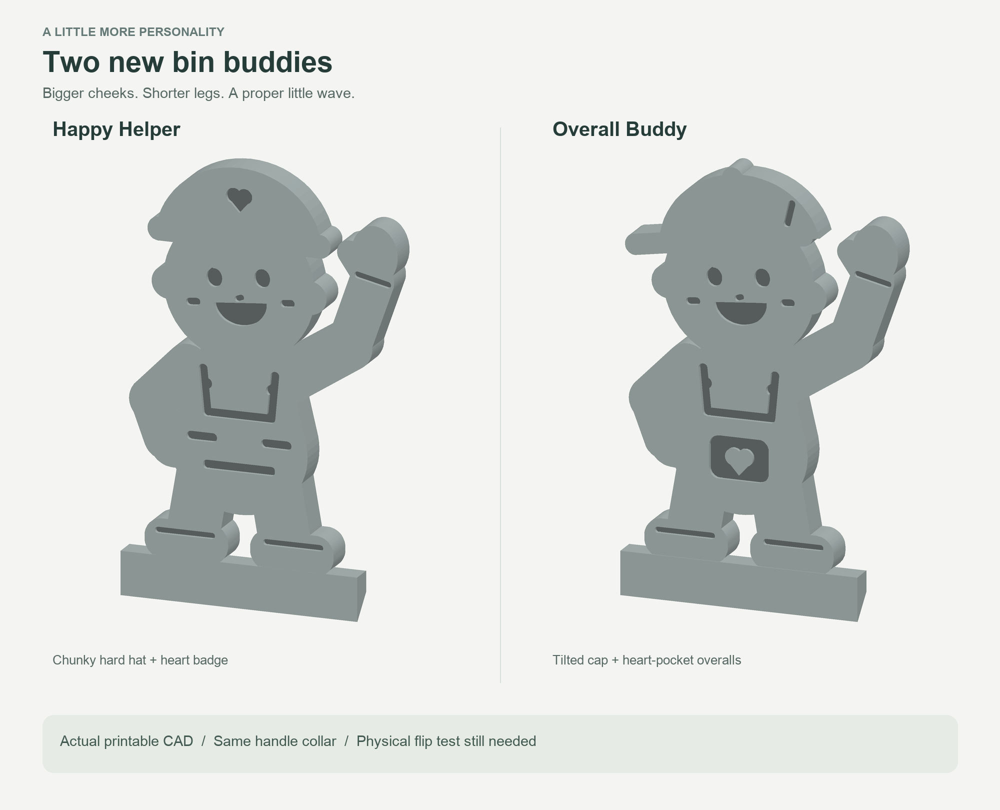

# Bin Buddies v2

Two rounder, friendlier flip-man characters for Richard's trash-bin pickup indicator. Both replace the large plain paddle and stem with a compact body, oversized head, cheek dimples, short legs, chunky boots, and a bent mitten wave.

For the later version with the figure turned 90 degrees into the clip's profile plane, see [Bin Buddies v3](../bin-buddy-flip-man-v3/README.md).



- **Happy Helper:** broad hard hat with an engraved heart badge and workwear stripes.
- **Overall Buddy:** tilted baseball cap and overalls with a raised heart inside the recessed pocket.

These are previews rendered from the final printable meshes. They are not photos of completed prints. Design date: 2026-10-28.

## Ready projects

| Version | Bambu Studio project | Estimated total time | PETG including supports |
| --- | --- | --- | --- |
| Happy Helper | [Sliced 3MF](sliced/helper/Happy_Helper_P1S_PETG.3mf) | 1h 47m | 30.35 g |
| Overall Buddy | [Sliced 3MF](sliced/buddy/Overall_Buddy_P1S_PETG.3mf) | 1h 48m | 30.43 g |

Both projects contain one connected part and embedded sliced G-code. They use a Bambu Lab P1S with a 0.4 mm nozzle, one gray Generic PETG filament, 0.20 mm layers, four walls, 5% gyroid, 255 C nozzle, 70 C Textured PEI bed, and an 8 mm3/s volumetric limit. Organic tree supports start on the build plate, with a 0.24 mm top gap and two interface layers; the brim is automatic at 5 mm. There are 205 layers. Estimates include startup and supports at Standard 100% speed.

Confirm the live printer and loaded PETG mapping before dispatch. No print was started for this design exploration.

## Fit and balance

- The complete original smaller handle collar, its opening, and the long lid-contact arm are retained. Richard confirmed that the earlier smaller fit coupon fit the household bin.
- Removed the old paddle and most of its plain stem above source Y=-7.8 mm. The new boots overlap the remaining neck, leaving a small mounting plinth instead of a large rectangular sign beneath the character.
- The characters are 4.6 mm thick, with 0.55 mm face and clothing recesses on both sides. The original 35 mm collar width is unchanged.
- Both are approximately 103 x 93 x 40.93 mm in print orientation. Keep the supplied orientation and scale. The previews rotate them upright for viewing.
- Uniform-solid calculations put the balance direction around the assumed handle axis within 0.2 degrees of the original for Happy Helper and 0.9 degrees for Overall Buddy. This informed the chosen thickness. Actual infill, friction, lid motion, and the installed bin can change behavior.

**Physical fit and flip behavior of these complete characters remain untested.** After printing, let the part cool, remove supports and brim, confirm the collar rotates freely, and simulate a pickup to check that the character flips and clears the lid.

## Validation

- Each final STL is watertight, with exactly one connected component, zero boundary or non-manifold edges, and zero degenerate triangles.
- OpenSCAD symmetric-difference checks are empty below source Y=-9.0 mm for both versions. This region contains the complete curved handle collar and long contact arm. Both check logs intentionally end with `Current top level object is empty.`
- Final Bambu Studio 02.08.02.61 slices succeeded with return code 0 and empty model/plate warning messages. Sliced archives were checked for corruption, embedded G-code, geometry, and PETG/P1S settings.
- Detailed mesh bounds, hashes, centers of mass, and approximate balance results are in `validation/mesh-validation.json`.

## Origin and license

- Mechanical donor: [Bindicator by user_1770727599](https://makerworld.com/en/models/2889779-bindicator), retained unchanged in `source/Bindicator_Original_Geometry.stl`.
- Donor and remix license: [Creative Commons Attribution-NonCommercial 4.0](https://creativecommons.org/licenses/by-nc/4.0/).
- Richard's original visual reference: [Instagram reel](https://www.instagram.com/reel/De3QnJYx-w1/).
- Both characters are original silhouettes and details created for this personal remix; they build on the previous local [Flip Man](../bin-buddy-flip-man/README.md).

## Files and rebuilding

- `Bin_Buddies.scad`: editable parametric CAD. `style="helper"` or `style="buddy"` selects the character; `mode="model"` is the print orientation.
- `Happy_Helper.stl`, `Overall_Buddy.stl`: complete printable meshes.
- `*_P1S_PETG_Prepared.3mf`: editable projects before slicing.
- `sliced/helper/`, `sliced/buddy/`: final sliced 3MFs with embedded G-code, slice results, and logs.
- `images/`: complete model and character closeups rendered from the final STL.
- `source/P1S_PETG_Template.3mf`: internal settings template from the earlier local project; not a v2 print file.
- `scripts/prepare.py`: NumPy/Pillow mesh checks, STL preview rendering, and prepared-project export.

Export the meshes from this folder:

```sh
openscad --export-format binstl -D 'style="helper"' -o Happy_Helper.stl Bin_Buddies.scad
openscad --export-format binstl -D 'style="buddy"' -o Overall_Buddy.stl Bin_Buddies.scad
python3 scripts/prepare.py
```

Check retained geometry by adding `-D 'mode="preservation_check"'` to either OpenSCAD command and choosing a separate output filename. An empty object and no STL are the expected result for that check.

To slice, run Bambu Studio CLI from the relevant output folder with `--slice 0 --outputdir . --export-3mf Happy_Helper_P1S_PETG.3mf ../../Happy_Helper_P1S_PETG_Prepared.3mf` (substitute the Overall Buddy names for the second version). Keep `--export-3mf` as a filename because this CLI prepends the output directory.

Loose G-code is omitted from the repository; it is embedded in each sliced 3MF.
