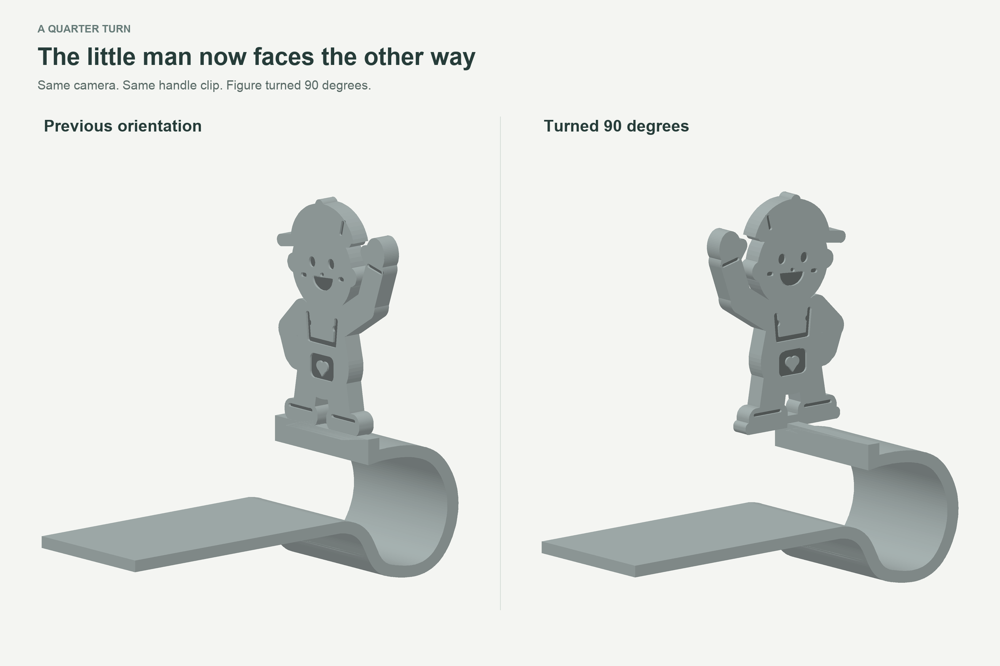
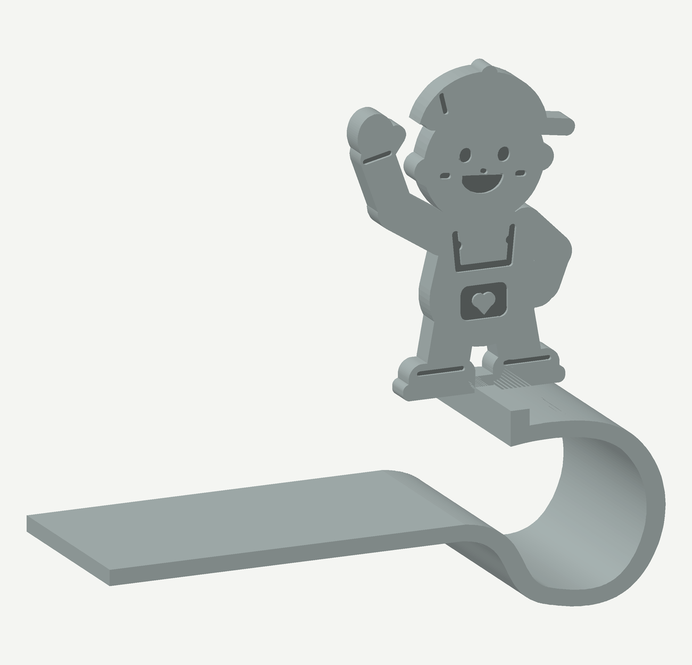

# Bin Buddies v3: perpendicular figure

The same round characters as v2, turned 90 degrees so the face lies in the plane of the C-shaped handle clip, perpendicular to the face orientation in v2. Richard requested this layout after comparing the social reference. The original smaller collar and complete lid-contact arm remain unchanged.



Design date: 2026-10-28. These images render the actual printable STL meshes. The centered Overall Buddy prototype was sent to the printer on 2026-10-28; physical bin testing remains pending.

## Centered variant, preferred for the next functional test

Richard asked whether the turned figure was centered and whether the clip needed its full width. The first v3 figure was mounted at the end for face-flat printing. Its complete solid-mesh center of mass was 4.23 mm away from the collar midpoint. The new **Overall Buddy Centered** variant moves the character 15.2 mm along the handle, centering its 4.6 mm thickness within the 35 mm collar. The full part's calculated axial center of mass is now exactly 17.5 mm. Its volume and center of mass in the flip plane are unchanged from the edge-mounted version.



- Preferred project: [Overall Buddy Centered](sliced/centered/Overall_Buddy_Centered_P1S_PETG.3mf).
- Final slice: **1h51m39s total, 32.93 g PETG**, including supports and startup; 146 layers at 0.24 mm. Uses the same P1S/0.4 mm, solid PETG, temperatures, flow limit, four walls, and organic build-plate supports as below.
- The centered figure needs more supports. The earlier edge-mounted projects remain available at 0.20 mm.
- Both the complete handle collar and long contact arm remain unchanged. The centered mesh is watertight, has one connected component, and passes the empty protected-region symmetric-difference check. See `validation/centered-validation.json`.
- One full-size centered Overall Buddy was dispatched on 2026-10-28 after Richard authorized printing below two hours and confirmed the build plate was clear. The final GUI slice/send estimate was **1h46m / 32.93 g**, with gray PETG mapped to AMS A1 on P1S, 0.4 mm nozzle, auto bed leveling on, timelapse off, and Standard 100% speed. The printer accepted the job, completed its download, and showed 0/146 layers waiting for the bed to reach 70 C, with an estimated finish of 21:52 local. Physical rotation, lid clearance, and reliable flipping remain untested.

The public dispatch snapshot is retained in `sliced/centered/dispatch-summary.json`. Printer screenshots and detailed local control records remain outside this archive. This snapshot verifies acceptance and heating, not print completion or successful installation. Inspect the live printer before sending another copy.

The **opening size** and **axial clip width** are different dimensions. The opening is unchanged from the smaller fit ring Richard confirmed. The full 35 mm axial width comes from the donor model, rather than a measurement of Richard's bin. The successful coupon was only 6 mm wide, so it does not prove full-width snap-on stiffness, clearance from nearby ribs, or free rotation. Exact 35 mm width is not established as necessary. Richard authorized the full-size centered prototype with this width and confirmed opening, without another fit coupon. Check installation and flipping on the finished part; do not enlarge or shrink the successful opening to change axial width.

To rebuild the centered mesh, add `-D 'variant="centered"' -D 'style="buddy"'` to the OpenSCAD command. The original default remains `variant="edge"` to preserve the earlier delivered files. `Overall_Buddy_Centered.stl` and `Overall_Buddy_Centered_P1S_PETG_Prepared.3mf` are the centered mesh and editable project.

## What changed

- Character face moved from the YZ plane into the XY plane. This turns the figure relative to the clip without turning or scaling the mechanism.
- The 4.6 mm thick character sits at one end of the original 35 mm wide collar, allowing it to lie flat on the print bed. Both sides retain the engraved facial and clothing details.
- A rounded 30 x 2.9 mm bridge joins both boots to the remaining original neck. Its lowest point is above source Y=-9 mm, clear of the retained collar geometry.
- The same two styles remain: **Happy Helper**, with a hard hat and heart badge; **Overall Buddy**, with a tilted cap and heart-pocket overalls.
- Use the supplied print orientation at 100% scale. The upright images are viewing orientations.

## Prepared print files

| Style | Sliced Bambu project | Total estimate | PETG |
| --- | --- | --- | --- |
| Happy Helper | [Open 3MF](sliced/helper/Happy_Helper_P1S_PETG.3mf) | 1h 20m 44s | 27.49 g |
| Overall Buddy | [Open 3MF](sliced/buddy/Overall_Buddy_P1S_PETG.3mf) | 1h 19m 51s | 27.35 g |

Both are single connected parts with embedded sliced G-code for a Bambu Lab P1S and 0.4 mm nozzle: one gray Generic PETG filament, 0.20 mm layers, 175 layers, four walls, 100% zig-zag infill, 255 C nozzle, 70 C Textured PEI bed, 8 mm3/s volumetric limit, automatic 5 mm brim, and organic tree supports on the build plate. Estimates include startup and supports at Standard 100% speed.

Solid infill keeps the face-flat character from becoming much lighter than the previous upright-printing figure and brings the print closer to the solid-mesh balance calculation. The new orientation needs considerably less support around the character.

The edge-mounted versions have not been dispatched. The centered version's dispatch is recorded above.

## Checks and physical limits

- Both final STL meshes are watertight and contain exactly one connected component, with zero boundary edges, non-manifold edges, or degenerate triangles.
- Symmetric-difference CAD checks below source Y=-9 mm are empty for both styles. This region contains the full curved handle collar and long contact arm; these solids are unchanged.
- Approximate bounds are 103 x 93 x 35 mm. The original collar opening and 35 mm width remain unchanged. Richard previously confirmed that the smaller fit coupon fit his bin; these complete v3 models remain untested.
- Uniform-solid estimates change the balance direction around the assumed handle axis by approximately 0.8 degrees for Happy Helper and 1.4 degrees for Overall Buddy compared with the original donor. The character is mounted at the end of the collar, shifting the center of mass along the handle from 17.5 mm to about 13.2 mm within its 35 mm width. Actual friction, clearances, material deposition, and lid motion can change behavior.
- Final Bambu Studio 02.08.02.61 slices succeeded with return code 0 and empty model/plate warning messages. Archives, embedded G-code, final geometry, and printer/material settings were verified.

After a print cools, remove supports and brim, check that the collar turns freely, and simulate a pickup. Confirm lid clearance, free rotation without side binding, and that the figure flips and stays captured.

## Origin and license

- Mechanical donor: [Bindicator by user_1770727599](https://makerworld.com/en/models/2889779-bindicator), retained in `source/Bindicator_Original_Geometry.stl`.
- Donor and remix license: [Creative Commons Attribution-NonCommercial 4.0](https://creativecommons.org/licenses/by-nc/4.0/).
- Original characters from the local [Bin Buddies v2](../bin-buddy-flip-man-v2/README.md).
- Visual reference: Richard's [Instagram reel](https://www.instagram.com/reel/De3QnJYx-w1/), whose linked [Ready Eddie product](https://www.amazon.com/dp/B0H4RVDFK6) shows the figure in the plane of the curved clip. The character artwork and adapted donor mechanism here are distinct CAD.

## Files and rebuilding

- `Bin_Buddies.scad`: editable source, with `style="helper"` or `style="buddy"`.
- `Happy_Helper.stl`, `Overall_Buddy.stl`: complete printable meshes.
- `*_P1S_PETG_Prepared.3mf`: prepared, editable projects.
- `sliced/helper/`, `sliced/buddy/`: final sliced projects with embedded G-code, estimates, and logs.
- `validation/`: mesh and CAD-preservation evidence.
- `images/`: complete model previews, character closeups, and matching-camera comparison.
- `scripts/prepare.py`: mesh checks, STL rendering, and prepared-project generation. Uses NumPy and Pillow, plus the retained internal settings template in `source/`.
- `scripts/orientation_preview.py`: matching-camera comparison against v2; requires the sibling v2 project.

Rebuild from this directory:

```sh
openscad --export-format binstl -D 'style="helper"' -o Happy_Helper.stl Bin_Buddies.scad
openscad --export-format binstl -D 'style="buddy"' -o Overall_Buddy.stl Bin_Buddies.scad
python3 scripts/prepare.py
python3 scripts/orientation_preview.py
```

Use `mode="preservation_check"` for an empty symmetric-difference check against the original retained mechanism. `Current top level object is empty.` and no exported STL are the expected results.

Slice from each `sliced/<style>/` folder using Bambu Studio CLI with `--slice 0 --outputdir . --export-3mf <Name>_P1S_PETG.3mf ../../<Name>_P1S_PETG_Prepared.3mf`. Pass an export filename rather than an absolute path because this CLI prepends the output directory.

Loose G-code is omitted from the repository; it is embedded in each sliced 3MF.
