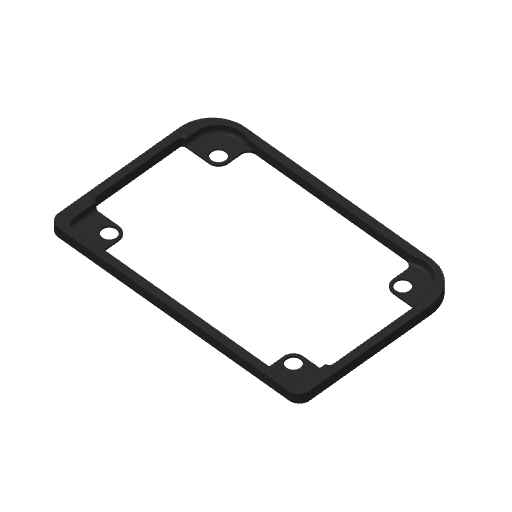

# Porsche 924 / 944 front speaker spacer

The 168 × 110 × 7 mm face spacer from the **BD Racing Porsche 924 / 944 Front Speaker Spacer Kit**, with a minimal mesh repair and Richard's saved PETG project for the Bambu P1S.

## Origin and version

- Category: Remix / repaired download.
- Source: [Printables model 801016](https://www.printables.com/model/801016-bd-racing-porsche-924-944-front-speaker-spacer-kit).
- Related designer discussion: [Spacers for more front speaker clearance](https://rennlist.com/forums/924-931-944-951-968-forum/1402502-3d-printed-solution-spacers-for-more-front-speaker-clearance.html).
- Base file: `Face_Spacer_Rev2.STL`.
- Final project: September 27, 2026; recovered and validated October 18, 2026.
- The source URL was recorded in the original repair conversation. The live Printables page could not be fetched during recovery, so the creator's account name and source license remain unverified. No new license or redistribution permission is asserted here.

## Files

| File | Purpose |
| --- | --- |
| `Face_Spacer_Black_PETG_Smooth_P1S_Fixed.3mf` | Final corrected PETG project, copied byte for byte from the September 27 output. Start here for a repeat print. |
| `Face_Spacer_Rev2_fixed.stl` | Export of the final 3MF's embedded mesh, translated to minimum XYZ = 0. Geometry and scale are unchanged. |
| `source/Face_Spacer_Rev2.STL` | Original downloaded mesh, retained for provenance; contains the original non-manifold defect. |
| `images/plate-preview.png` | Preview embedded in the final project. |
| `slice-validation.json` | Bambu Studio CLI validation result from October 18, 2026. |
| `SHA256SUMS` | File integrity checksums. |

## Repair history

The original mesh and the OpenSCAD-exported `Untitled.stl` retained overlapping triangles at a seam. The final repair removed only four coincident triangles (indices 21514, 21537, 21538 and 21539 in the saved RJW mesh). The lower rail, opening and screw holes were preserved.

The final mesh has **26,850 triangles**, consistent winding, a watertight surface and no edges with other than two adjacent faces. Its volume is approximately 21,198.53 mm³.

The earlier `Face_Spacer_Rev2_repaired.stl` added about 749 mm³ of material and was rejected because it changed the opening. During recovery, both older PLA 3MFs were also found to contain that broader repair despite their filenames. The `OriginalShape - RJW.3mf` save contains the unrepaired mesh. Those revisions are intentionally excluded from the repeat-print files here.

## Repeat printing

Open the final **3MF as a project**, retain its saved settings, confirm the loaded PETG and current AMS mapping, then slice and review the preview.

| Setting | Saved / resolved value |
| --- | --- |
| Printer | Bambu Lab P1S, 0.4 mm nozzle |
| Material | Black Generic PETG, project filament 3 |
| Plate | Textured PEI Plate |
| Layer height | 0.12 mm; initial layer 0.2 mm |
| Walls | 3 |
| Top / bottom shell layers | 5 / 5 |
| Infill | 25%, grid |
| Supports | Disabled |
| Brim | Auto |
| Outer wall / top surface speed | 80 / 80 mm/s |
| Nozzle / bed temperature | 255°C / 70°C in generated G-code |
| Orientation | Flat, as saved in the 3MF |

The filename says `Smooth`, but the actual selected plate is **Textured PEI**. The process preset name is a legacy `0.08mm Extra Fine @BBL X1C` label; the saved printer and effective layer height are P1S and 0.12 mm. The original project is preserved unchanged, including these labels.

## Validation and use

Bambu Studio 02.08.02.61 sliced the final project successfully on October 18, 2026: return code 0, no warning message, one 168 × 110 × 7 mm object, PETG filament 3, approximately **63 minutes 25 seconds** and **19.43 g**. Temporary G-code was used only for validation and is not the archival print source.

The standalone STL was reloaded and checked for matching triangles within STL floating-point precision, dimensions, watertightness and winding. The original 3MF also passed ZIP integrity checks.

Richard reports having printed this spacer previously. Recovery and slicing validation do not independently establish vehicle fitment or a new physical print result. This folder contains the face spacer only, not every component of the source kit.
